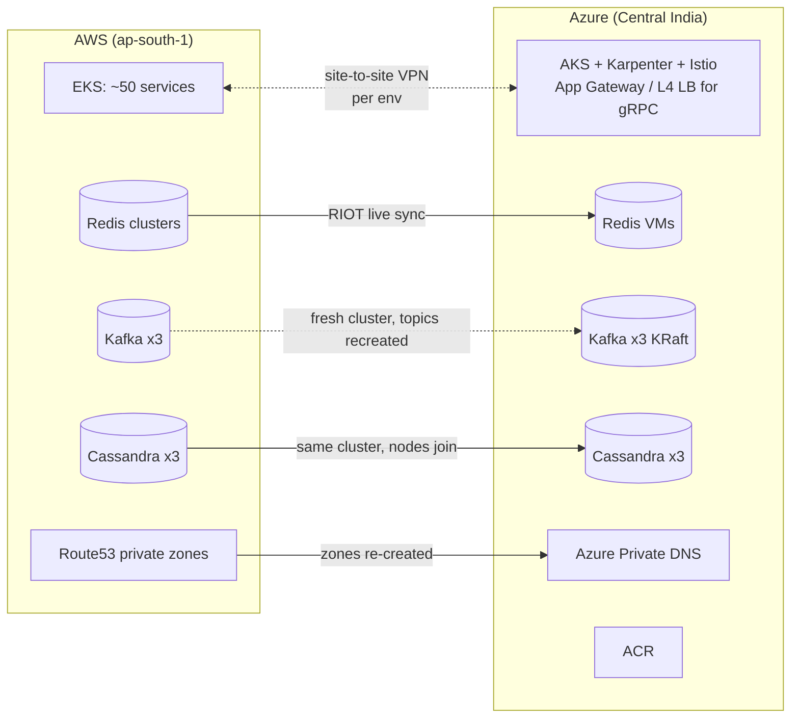

# AWS → Azure migration: EKS to AKS, plus Redis, Kafka, Cassandra and DNS

Case study: moving a live-streaming and gaming platform's **staging and production** from AWS to Azure (Central India). In scope were about 50 microservices on EKS, the self-managed Redis, Kafka, Cassandra and Elasticsearch, internal DNS, CI/CD and monitoring. The platform kept serving traffic the whole time: stage moved first, then prod services were switched over in batches, and each data store got a migration method that suited it.

> Sanitized from real work. Company, domain, hostnames, IPs, account IDs and people are removed. My role: I planned and ran the infrastructure, application, Redis, Kafka, Cassandra, Elasticsearch and DNS migration, with one colleague helping on VM setup and monitoring. **MySQL/ProxySQL were migrated by other teams**, and the **MongoDB Atlas** cloud-provider change was done by the client's team.

## Architecture during the migration



## Migration method per component

| Component | Method | Cutover |
|---|---|---|
| Networking | Site-to-site VPN (Azure VNG ↔ AWS), separate tunnels for stage and prod. VPN server for engineers | Tunnels removed after cutover |
| Internal DNS | Azure Private DNS zones + DNS Private Resolver forwarding to Route53 during coexistence | Zones re-created in Azure, forwarding ruleset disabled |
| Images / CI | Azure Container Registry, new Azure branches, Jenkins redeploys | Per service |
| Apps (EKS → AKS) | Same Helm/Istio pattern on AKS. Naming convention standardised | Stage switched in one go. Prod in batches by DNS |
| Redis (self-managed clusters) | Same version on Azure VMs. **RIOT** initial copy + live sync (keyspace notifications enabled on the source) | DNS repoint per cluster, then AWS nodes stopped |
| Kafka | **Fresh** 3-broker cluster (KRaft). No data copy needed, topics/configs recreated. Disks right-sized | DNS repoint. AWS brokers stopped (exact producer/consumer switch order [UNKNOWN]) |
| Cassandra | Azure nodes **joined the existing cluster**, so Cassandra streamed the data itself | AWS nodes removed after validation |
| Elasticsearch / APM | Set up in Azure | [UNKNOWN] whether data was migrated or started fresh |
| MySQL / ProxySQL | Done by other teams (not my work) | — |
| MongoDB Atlas | Cloud-provider change done by the client team | — |

## Status

| Item | Status |
|---|---|
| Migration plan shared (EKS, Redis, Cassandra, MySQL, ProxySQL, Kafka, MongoDB Atlas) | Done |
| VPN, private DNS, VPN server for engineers, ACR, AKS + CI/CD | Done |
| Stage on AKS (47 of 53 services up on the first pass, the rest after dev-team fixes), all stage domains switched, AWS stage deleted | Done |
| Prod: 46 services healthy on AKS before cutover. Remaining services moved in batches. Last ones (websocket, auth/user-type services) switched about 2.5 weeks later | Done |
| Redis: all prod clusters synced with RIOT live mode, switched by DNS, AWS nodes stopped the same day | Done. Spot check on one cluster: RIOT compare 362,385 / 362,385 keys OK |
| Kafka: fresh 3-node cluster with monitoring + UI, then AWS brokers stopped | Done |
| Cassandra: 3 Azure nodes joined one at a time (`nodetool status` all UN), then AWS nodes removed | Joined: verified. Removal method (`decommission` vs `removenode`) [UNKNOWN] |
| Internal hosted zones moved to Azure Private DNS. Azure no longer depends on the AWS tunnel | Done |
| VM backups, Grafana monitoring and alerting for all Azure VMs and AKS | Done |
| AWS cleanup: stage deleted, backend EC2 terminated, old snapshots/AMIs removed, prod EKS kept with 0 worker nodes | Done |
| Transcoding stack (separate cluster, RTMP/RTMPS ingest, HLS egress) | Done ~2 months later. Tested end to end with OBS before switching |
| A job/setup that existed in AWS was missed and found ~2 months later | Rebuilt in Azure afterwards. Details [UNKNOWN] |
| `CLUSTERDOWN` errors from one app during the Redis cutover | Seen in my notes. Root cause / fix [UNKNOWN] |
| Total cost before vs after | [UNKNOWN], not in my notes. Post-migration cost work is listed in [docs/post-migration.md](docs/post-migration.md) |

## Repo layout

```
docs/migration-plan.md   strategy, order, risks
docs/manual-steps.md     step-by-step runbook per phase (sanitized)
docs/timeline.md         dated timeline
docs/gotchas.md          what bit me (gRPC/LB, idle timeouts, quotas, IAM, DNS, Atlas peering...)
docs/post-migration.md   cleanup + optimisation after cutover
manifests/               Istio gRPC gateway LB (reconstruction)
scripts/                 redis RIOT sync, cassandra join/remove, kafka topic recreate, DNS cutover check (UNTESTED reconstructions)
```

## Honesty notes

- Facts come from my Slack updates and project notes. Commands are sanitized. Scripts and manifests are **reconstructions**.
- **Correction:** early in the project I wrote that VMs would be AMD because "no Graviton/ARM support in Central India". Later I built the Cassandra VMs on **Azure ARM sizes (Dpsv6)**. MySQL/ProxySQL stayed on AMD/x86.

## License

MIT
